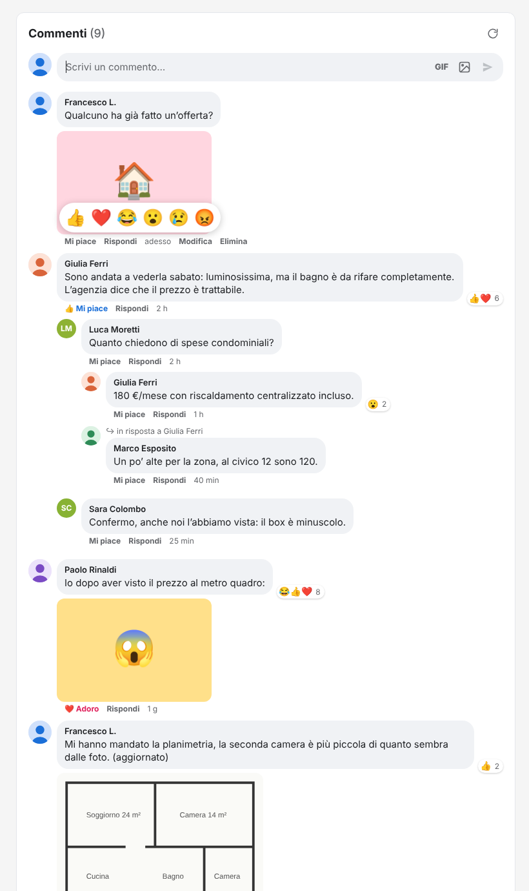

# Commenti per idealista

Estensione per Chrome che aggiunge i **commenti sotto gli annunci di idealista**: risposte, reazioni con le emoji (👍 ❤️ 😂 😮 😢 😡), GIF e immagini. Accedi con il tuo profilo Chrome, senza registrarti.

## Installazione (2 minuti)

1. **Scarica** l’ultima versione: vai su [**Releases**](../../releases/latest) e scarica `commenti-per-idealista.zip`.
   *(In alternativa: pulsante verde **Code → Download ZIP** in questa pagina.)*
2. **Estrai** lo zip in una cartella che non cancellerai (per esempio *Documenti/commenti-per-idealista*).
3. In Chrome apri **`chrome://extensions`**.
4. In alto a destra attiva **Modalità sviluppatore**.
5. Clicca **Carica estensione non pacchettizzata** e seleziona la cartella estratta (quella che contiene `manifest.json`).
6. Apri un annuncio su [idealista.it](https://www.idealista.it), scorri sotto la descrizione e clicca **Accedi con Chrome**.

> 💡 Fissa l’icona dell’estensione (puzzle 🧩 → spilla 📌) per vedere il tuo profilo e uscire quando vuoi.

### Aggiornare
Scarica il nuovo zip, sostituisci il contenuto della cartella e in `chrome://extensions` premi ↻ sull’estensione.

## Domande frequenti

**Vedo “Accesso non riuscito” o un errore di Google.**
L’estensione è ancora in fase di prova: per ora possono accedere solo gli account abilitati. Chiedi a chi te l’ha condivisa di aggiungere la tua email Google. Puoi comunque **leggere** i commenti senza accedere.

**Funziona su idealista.com (Spagna) e idealista.pt?**
Sì, su tutti e tre i siti.

**Chi vede i miei commenti?**
Tutti quelli che usano l’estensione, insieme al nome e alla foto del tuo account Google. Vedi la [privacy](PRIVACY.md).

**Posso cancellare un commento?**
Sì: sotto ogni tuo commento ci sono **Modifica** ed **Elimina**.

---

Non affiliato a idealista. Codice sorgente completo (estensione + server): [francescoloiusays/idealista-commenti](https://github.com/francescoloiusays/idealista-commenti). Licenza MIT.
